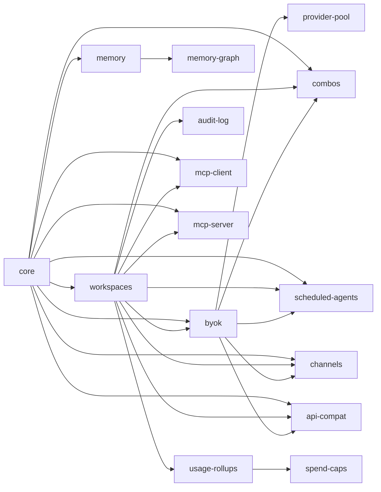

# Feature Catalog — models-rahmanef-com

Every feature here is a **vertical slice** under `web/frontend/slices/<slug>/` (UI + types)
and, where it has a backend, `web/convex/features/<slug>/` (schema tables only — the queries,
mutations and actions stay at the convex root and are listed in `slice.json → convex.rootPaths`).
Slices are **mix-and-match**: you install only the ones you want, and each declares the
other slices it needs in `slice.manifest.json → deps.slices`. Nothing reaches into the app
root — a CI guard (`web/scripts/check-slice-boundaries.mjs`) enforces it.

> Distribution = **file-copy** (the rr `npx rr add <slug>` model), not npm. Copying a slice
> also copies its `convex/features/<slug>/` **+ the files in its `slice.json → convex.rootPaths`**,
> and a `convex codegen` regenerates the API — so
> there's no per-deployment code to hand-edit.

## Submenu

- [Starter](#starter) — prerequisites, the base install, first run
- [How rr features connect](#how-rr-features-connect) — deps, the AI-model requirement, external connectors
- [Dependency graph](#dependency-graph)
- **Feature pages**
  - [core](#core) · [workspaces](#workspaces) · [byok](#byok) · [provider-pool](#provider-pool)
  - [memory](#memory) · [memory-graph](#memory-graph)
  - [combos](#combos) · [scheduled-agents](#scheduled-agents) · [channels](#channels)
  - [api-compat](#api-compat) · [mcp-client](#mcp-client) · [mcp-server](#mcp-server)
  - [usage-rollups](#usage-rollups) · [spend-caps](#spend-caps) · [audit-log](#audit-log)
- [Install & run — cd + commands](#install--run)

---

## Starter

### Prerequisites

| Need | Version / value |
|---|---|
| Node | ≥ 22.6 |
| Package manager | `pnpm` (repo uses `pnpm-lock.yaml`) |
| Framework | Next.js 16 + React 19 (App Router; `proxy.ts`, not middleware) |
| Backend | Convex ≥ 1.16 (this repo: Convex Cloud dev `woozy-cow-48` / prod `moonlit-mongoose-56`) |
| Auth | `@convex-dev/auth` (peer of **every** feature — no Clerk) |

### The base you almost always install first

```
core          # shared UI kit + helpers — dependency of nearly everything, no backend
workspaces    # multi-tenant + RBAC — the auth/authz base most features build on
byok          # the AI-model connector (see below) — required by anything that runs a model
```

- **Single-user AI, no tenancy?** Minimum is `core + byok`.
- **Multi-tenant app?** Install `core + workspaces + byok`, then add features on top.

### Environment

| Var | Needed by | What |
|---|---|---|
| `MODELS_ENC_KEY` | **byok**, channels, mcp-client | AES-256-GCM key that encrypts stored provider keys / secrets. Required or credential writes fail. |
| `NEXT_PUBLIC_CONVEX_URL` | app | Convex deployment URL (injected on deploy). |
| `CONVEX_DEPLOYMENT` | tooling | Set by `convex dev` / deploy. |

Never put secrets behind `NEXT_PUBLIC_` — that prefix ships to the browser.

---

## How rr features connect

**1. Dependency resolution.** A feature lists the slices it needs in `deps.slices`. Installing
it means installing those too (transitively). Example: `channels` → `["core","workspaces","byok"]`.
Cross-slice code imports go through the barrel only: `import { X } from "@/features/<slug>"` —
never a deep path into another slice's internals.

**2. The AI-model requirement (the important one).** Anything that *runs a model* — **agents**
(app-level), **combos**, **scheduled-agents**, **channels**, chat/workbench, embed — needs
**byok** connected with at least one provider. **byok is the "AI SDK model" feature**: it wraps
`@ai-sdk/openai | anthropic | google`, OpenRouter, 28 OpenAI-compatible providers, plus OAuth
(ChatGPT/Codex, Claude Pro/Max, Copilot) and custom endpoints. Once a provider is connected, its
models flow into every model picker in the app. **No byok connected = no models = those features
are inert.** So the rule of thumb: *a feature that mentions "model", "agent", or "skill" depends
on byok.*

**3. Connecting EXTERNAL systems (rr → outside world).**

| Direction | Slice | What it connects |
|---|---|---|
| Pull external **tools** into your agents | **mcp-client** | any external MCP server (its tools become agent tools) |
| Accept external **inbound chat** | **channels** | Telegram · Slack · WhatsApp · Discord webhooks → your agents |
| Expose your gateway **as an API** | **api-compat** | an OpenAI/Anthropic-compatible `/v1` endpoint external apps can call |

**4. The boundary guard.** `web/scripts/check-slice-boundaries.mjs` (in the `pnpm test` chain,
runs in pre-push CI) fails the build if a slice imports the app root or a retired shared barrel —
so the modular boundary can't rot.

---

## Dependency graph



Every feature also has `@convex-dev/auth` as a peer.

---

## Feature pages

Each page: **what it is · requires · connects to · install**. "Requires" lists the rr slices
(auto-resolved), npm packages, env vars, Convex tables it owns, and RBAC scopes.

### core
The shared substrate every feature sits on. **No backend, React-only — the most portable slice.**
Ships `ResponsiveDialog`/`ConfirmDialog`/`useConfirm`, `SectionErrorBoundary`, `useTheme`,
`fmt`/`ago`/`dt`, and the generic `errData`/`ErrorLine`/`FRIENDLY` error renderer.
- **Requires:** slices — none · npm `lucide-react` · env — none · tables — none · RBAC — none
- **Connects to:** everything depends on it. Import via `@/features/core`.
- **Install:** `npx rr add core`

### workspaces
Multi-tenant workspaces + role-based access control (owner / admin / member / viewer), invites,
membership. The authz base other features gate on via `requireWorkspaceRole`.
- **Requires:** slices `core` · env — none · tables `workspaces, memberships, invites` · RBAC `authed-user`
- **Connects to:** combos, channels, scheduled-agents, api-compat, usage-rollups, spend-caps, audit-log all build on it.
- **Install:** `npx rr add core workspaces`

### byok
**The AI-model connector** (Bring-Your-Own-Key). Encrypted per-user/-workspace provider
credentials (AES-256-GCM), a provider registry (OpenAI/Anthropic/Google/OpenRouter + 28
OpenAI-compatible + OAuth + custom endpoints), health checks, and the model catalog that feeds
every picker.
- **Requires:** slices `core, workspaces` · npm `@ai-sdk/openai @ai-sdk/anthropic @ai-sdk/google @openrouter/ai-sdk-provider` · env **`MODELS_ENC_KEY`** · tables `modelCreds` · RBAC `authed-user`
- **Connects to:** **required by anything that runs a model** — combos, scheduled-agents, channels, api-compat, agents/chat (app-level).
- **Install:** `npx rr add core workspaces byok` — then set `MODELS_ENC_KEY` and connect a provider in the UI.

### provider-pool
Failover + cooldown across multiple keys for the same provider (picks up to 3 candidate creds,
skips ones on cooldown after a 402/429). Hardens byok for production.
- **Requires:** slices `byok` · tables `modelCreds` (shared with byok) · RBAC `authed-user`
- **Connects to:** transparent to callers — sits inside the byok call path.
- **Install:** `npx rr add core byok provider-pool`

### memory
Per-agent long-term memory: store, auto-summary, curation.
- **Requires:** slices `core` · tables `memories` · RBAC `authed-user`
- **Connects to:** agents read/write it; **memory-graph** visualizes it.
- **Install:** `npx rr add core memory`

### memory-graph
Obsidian-style force-directed graph over memories + agents + skills + tools. **Portable
`<MemoryGraph>` renderer** (feed it any `GraphData`) + a wired panel over the memory queries.
Ships its own scoped `<style>` — the one feature that needs no app CSS.
- **Requires:** slices `memory` · tables — none · RBAC `workspace-viewer`
- **Connects to:** reads the `memory` slice's data.
- **Install:** `npx rr add core memory memory-graph`

### combos
Saved multi-model "combos" (route/compare across several models at once).
- **Requires:** slices `core, workspaces, byok` · tables `combos` · RBAC `authed-user, workspace-member`
- **Connects to:** **needs byok** for the models it references; scoped to a workspace.
- **Install:** `npx rr add core workspaces byok combos`

### scheduled-agents
Cron-scheduled agent runs (an agent + a schedule → autonomous runs).
- **Requires:** slices `core, workspaces, byok` · tables `agentSchedules` · RBAC `authed-user, workspace-member`
- **Connects to:** **needs byok** (the agent runs a model); workspace-scoped.
- **Install:** `npx rr add core workspaces byok scheduled-agents`

### channels
Inbound messaging: **Telegram · Slack · WhatsApp · Discord** webhooks routed to your agents.
- **Requires:** slices `core, workspaces, byok` · env **`MODELS_ENC_KEY`** (channel secrets) · tables `channels, channelIdentities, channelEvents` · RBAC `authed-user, workspace-admin, webhook`
- **Connects to:** **external** platforms inbound; **needs byok** to answer with a model.
- **Install:** `npx rr add core workspaces byok channels`

### api-compat
Exposes the gateway as an **OpenAI/Anthropic-compatible `/v1` API** with per-user API keys —
external apps point their SDK at your URL.
- **Requires:** slices `core, workspaces, byok` · tables `apiKeys` · RBAC `authed-user, api-key`
- **Connects to:** **external** apps outbound; **needs byok** for the models it serves.
- **Install:** `npx rr add core workspaces byok api-compat`

### mcp-client
Connect **external MCP servers** so their tools become available to your agents (encrypted creds).
- **Requires:** slices `core, workspaces` · npm `@modelcontextprotocol/sdk` · env **`MODELS_ENC_KEY`** · tables `mcpServers` · RBAC `authed-user`
- **Connects to:** **external** MCP servers; the imported tools attach to agent runs (which need byok).
- **Install:** `npx rr add core workspaces mcp-client`

### mcp-server
The mirror of mcp-client: expose **your** gateway tools over MCP so Claude Code, Cursor, ChatGPT or
any MCP-aware agent calls them as you. Per-user bearer tokens (sha256 at rest, shown once) **plus** a
full OAuth 2.1 AS — dynamic client registration, PKCE S256, single-use 60s codes, both `.well-known`
documents. Tool set is whatever `convex/toolRegistry.ts` marks with the `mcp` surface.
- **Requires:** slices `core, workspaces` · tables `mcpTokens, mcpClients, mcpAuthCodes` · routes `/mcp`, `/oauth/*`, `/.well-known/*` · RBAC `authed-user, bearer-token`
- **Connects to:** **external** MCP clients inbound; the exposed tools run through the same handlers as agents (so most of them **need byok**).
- **Install:** `npx rr add core workspaces mcp-server`

### usage-rollups
Daily per-workspace usage aggregation (tokens / calls) for dashboards and caps.
- **Requires:** slices `workspaces` · tables `workspaceUsageDaily` · RBAC `workspace-viewer`
- **Connects to:** feeds **spend-caps**.
- **Install:** `npx rr add core workspaces usage-rollups`

### spend-caps
Per-workspace spend limits enforced against the usage rollups.
- **Requires:** slices `workspaces, usage-rollups` · RBAC `workspace-viewer, workspace-admin`
- **Connects to:** reads **usage-rollups**; blocks calls when over cap.
- **Install:** `npx rr add core workspaces usage-rollups spend-caps`

### audit-log
Append-only workspace audit trail (who did what, when).
- **Requires:** slices `workspaces` · tables `auditEvents` · RBAC `authed-user`
- **Connects to:** other features write events; workspace-scoped read.
- **Install:** `npx rr add core workspaces audit-log`

---

## Install & run

### A. Work in THIS repo (everything is already here)

```bash
cd ~/projects/models-rahmanef-com/web      # the Next app lives in web/

pnpm install                                # deps
# set MODELS_ENC_KEY (byok/channels/mcp-client) — e.g. in web/.env.local
#   MODELS_ENC_KEY=$(openssl rand -base64 32)

pnpm dev                                     # Next dev (add PORT=3111 to change port)
# in another shell, keep Convex functions live on the DEV deployment:
npx convex dev                               # or `npx convex dev --once` after a backend edit
```

Build / test / check:

```bash
cd ~/projects/models-rahmanef-com/web && pnpm build     # production build
cd ~/projects/models-rahmanef-com && pnpm test          # full chain incl. the boundary guard
```

Ship (solo-dev → main; do NOT run `convex deploy` by hand):

```bash
cd ~/projects/models-rahmanef-com
git add -A && git commit -m "feat(...): ..."
git push origin main      # pre-push hook: CI + auto-deploys prod Convex; Dokploy builds the frontend
```

### B. Adopt a feature into ANOTHER rr project

From the target project root:

```bash
cd ~/projects/<your-rr-app>

npx rr add core workspaces byok            # deps auto-resolve from each slice's deps.slices
npx rr add scheduled-agents                # adds the feature + pulls anything it still needs
npx convex codegen                         # regenerate the API for the copied convex/features/*

# then set the env the added features need (e.g. MODELS_ENC_KEY for byok) and connect a provider.
```

> No local `rr` CLI in this repo — it's the external rr tool. Manual fallback if you don't have it:
> copy `web/frontend/slices/<slug>/` → your `frontend/slices/<slug>/`, copy
> `web/convex/features/<slug>/` (+ the files in that slice's `slice.json → convex.rootPaths`) →
> your `convex/`, add the slice's `deps.slices` the same way, then `npx convex codegen`.

### Order that always works

Install **`core` first**, then **`workspaces`** and/or **`byok`**, then the feature. Because
every model-running feature needs byok, connect a provider in the UI before expecting agents,
combos, channels, or the `/v1` API to return anything.
